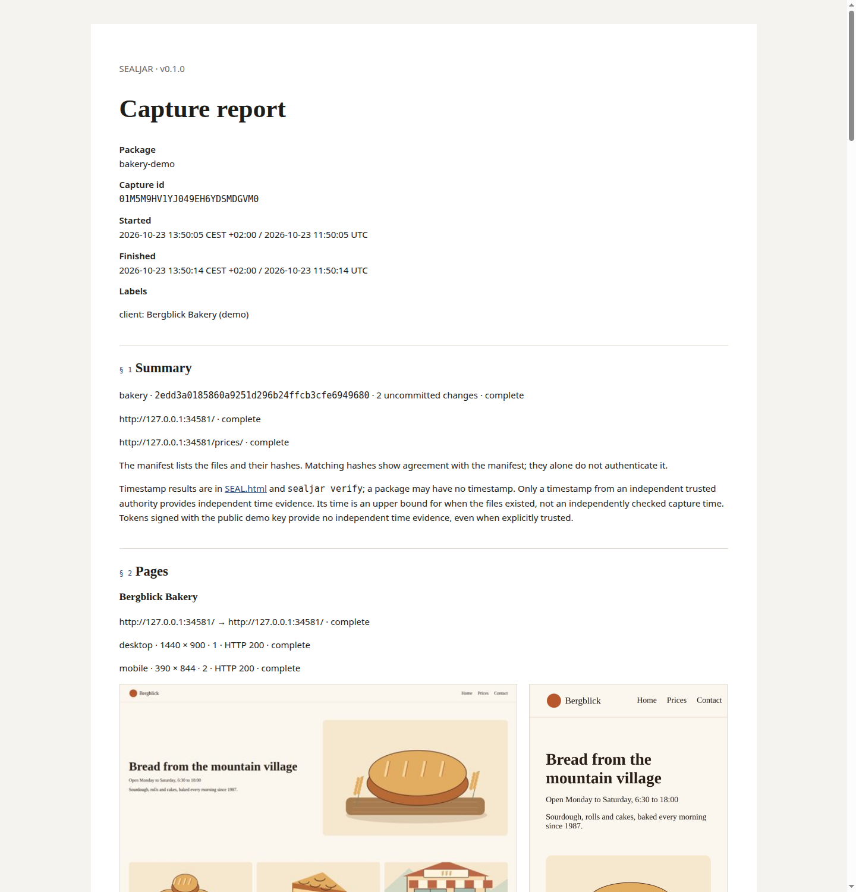
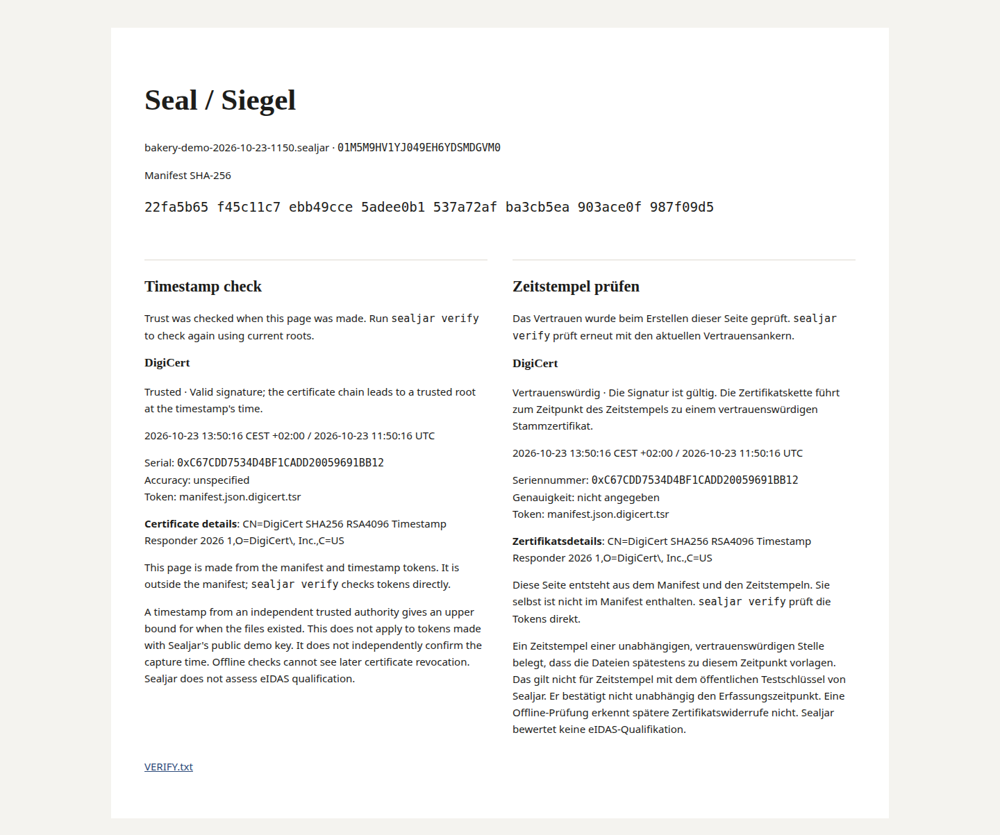

<p align="center">
  <picture>
    <source media="(prefers-color-scheme: dark)" srcset="docs/media/wordmark-dark.svg">
    
  </picture>
</p>
<p align="center"><b>Timestamped captures of your website and code.</b></p>
<p align="center">
  <a href="https://www.sealjar.com">Website</a> ·
  <a href="docs/quickstart.md">Get started</a> ·
  <a href="docs/for-recipients.md">Received a package?</a> ·
  <a href="docs/commands.md">Commands</a> ·
  <a href="AGENTS.md">AGENTS.md</a> ·
  <a href="docs/de/abnahme.md">Deutsch</a>
</p>

Sealjar is a free, open-source CLI that captures web pages and a Git repository
into one ZIP. It hashes every file, gets a timestamp from a timestamp authority
and seals the package. Later, `sealjar verify` checks whether the files still
match the manifest and whether the timestamp is trusted. It is for developers
and agencies who hand over a website and want a record of the site and the code
on that day.

## Capture with your coding agent

Copy this prompt into Claude Code or Codex and replace the URL with your own.
The agent reads AGENTS.md and installs Sealjar. It shows you the capture plan
before it runs. When the package is written, it verifies it and shows you the
report. The package lands in the parent directory of your repository.

```text
Use Sealjar to capture this repository and https://staging.example.com
for handover. Use https://github.com/vincentsch/sealjar: read its AGENTS.md
and follow the steps. Verify the package and show me the report and any
capture problems. Write the output to the parent directory of this repository.
```

For pages behind a login, see [capture](docs/capture.md).

## Install it yourself

Sealjar is one executable for Linux, macOS and Windows, on amd64 and arm64.
The installer runs on Linux, on macOS and in Git Bash on Windows. WSL gets the
Linux build. The installer checks the SHA-256 checksum of the download.

```sh
curl -fsSL https://raw.githubusercontent.com/vincentsch/sealjar/main/install.sh -o /tmp/sealjar-install.sh
bash /tmp/sealjar-install.sh
rm /tmp/sealjar-install.sh
```

The installer prints the absolute path on its `Installed:` line. Use that path
if `sealjar` is not on PATH. The examples below call the executable `sealjar`.
On native Windows, [download the executable with PowerShell](docs/quickstart.md#native-windows).
[Installing with Go](docs/quickstart.md#install) is optional on every platform.

Web capture and the demo need Chrome or Chromium. Code capture and the demo need
Git. Verify, report and restore need neither. Checking out a history bundle
needs Git. A code-only capture without Chrome writes HTML reports but no PDFs,
and `report --pdf` can only copy PDFs that exist.

On macOS, verifying a DigiCert timestamp may need an exported root bundle. See
[macOS and DigiCert](docs/timestamps.md#macos-and-digicert) for the observed
v0.1.0 results and the workaround.

## Try it

After [installing](#install-it-yourself), run:

```sh
sealjar doctor
sealjar demo --out ../bakery-demo
```

Doctor checks for Chrome and Git and probes the timestamp authorities. The demo
captures a bundled bakery website and an example repository, served on your own
computer. It writes the package and a reader folder with the report. It also
writes a second ZIP with one changed screenshot. Run `sealjar verify` on that
copy and the output names the file.

If no public timestamp authority answers, the demo signs with a local key and
labels the timestamp “Demo timestamp, not trusted”. Verify then exits 11. The key
is public, so that token says nothing about when the files existed, even if you supply verify a root that trusts it.

<p></p>
<p></p>

Both images come from a demo run that got a trusted DigiCert timestamp.

## Capture by hand

Run Sealjar from the root of your repository and write the package outside it.
Otherwise the next capture would include the last package. List every URL you
want; Sealjar does not follow links.

```sh
OUT=$(cd .. && pwd -P)
sealjar capture https://staging.example.com . --out "$OUT" --dry-run
```

The dry run prints the plan without starting Chrome or touching the network.
Check which files go in and which are left out, and where the package will be
written. If the plan is right, run the capture:

```sh
sealjar capture https://staging.example.com . --out "$OUT" --confirm --no-prompt
```

Add more URLs as arguments for more pages or hosts. A package holds those pages
and one Git repository. Tracked files are copied as they are in your working
tree, including uncommitted edits. `--include-untracked` adds files that Git
does not ignore. `--history` adds a Git bundle with all refs, which can contain
old secrets and unrelated work. Submodules are listed without their contents.
LFS pointers stay pointers unless the files are already present.

Sealjar leaves out `.env` files and common key files by default. The plan lists
each excluded file with the reason. Add your own rules with `--exclude 'build/'`
or `--exclude '*.key'`. A trailing slash excludes a folder tree; `**` is not
supported. These rules cannot catch all private content. Read
[capture and privacy](docs/capture.md) before you share source or screenshots.

## Check a package

Use the ZIP path that capture printed:

```sh
sealjar verify package.sealjar.zip
```

Verify gives three separate answers. Capture says whether every page and the
repository were captured and which problems were recorded. Files says whether
every listed file still matches its hash in the manifest. Timestamp says whether
a token is valid and comes from a trusted authority. Exit 0 means the files match
and at least one timestamp is trusted; the capture can still have recorded
problems. Exit 10 means changed or invalid content. Exit 11 means no trusted
timestamp. [Verification](docs/verify.md) explains the results.

Nobody needs Sealjar to read the report. `report/report.en.html` in the reader
folder opens in a browser; keep the folder together, because its image links are
relative. The PDF report stands on its own. To check a package without Sealjar,
`VERIFY.txt` inside the ZIP gives the steps: Python 3 compares the files with
the manifest, and OpenSSL checks the timestamp with roots you got yourself.
[Manual verification](docs/verify.md#without-installing-sealjar) explains them.

A package shows that the listed files existed no later than the timestamp's time
and that they are unchanged since. It cannot show:

- that the content is true or complete
- that the server sent those bytes, or that the operator was honest
- that a project was delivered or accepted
- that the captured code produced the captured website

Matching hashes alone cannot vouch for a manifest without a timestamp, because
someone could replace the files and the list together. The timestamp does not
check when the capture was made. Courts weigh evidence freely; Sealjar promises
no legal effect and no admissibility. For an important dispute, have a neutral
person present during the capture, for example an expert or a notary.

## Timestamps and network access

DigiCert is the default timestamp authority and FreeTSA the fallback. Repeat
`--tsa` to use other authorities instead. If no authority answers, the package is
written without a timestamp, and `sealjar stamp` adds one later without changing
the manifest or the captured files. See [timestamps](docs/timestamps.md).

Verify trusts the system's root certificates, the FreeTSA root that ships with
Sealjar, and roots you supply with `--tsa-root`. Certificates that only come inside
the package are not trusted. An offline check cannot see a later revocation.
Sealjar v0.1 does not assess eIDAS qualification and never calls a timestamp
qualified.

Capture loads the listed pages with everything they load. It asks DNS servers
about each host and sends the manifest hash to the timestamp authority, which
receives that hash and normal network metadata. Timestamp requests use the
standard proxy variables; doctor's connection probes do not. There are no
Sealjar accounts and no uploads. Screenshots and HTML can still show private
content, and source files and Git history can contain secrets. Masking and
exclusions do not catch everything. Look through the package before you share it.

## Read more

The [quickstart](docs/quickstart.md) covers your first capture. The
[recipient guide](docs/for-recipients.md) explains what to do with a package you
received. The [FAQ](docs/faq.md) and the [command reference](docs/commands.md)
answer the rest. In German: [Abnahme](docs/de/abnahme.md) and
[empfangene Pakete](docs/de/fuer-empfaenger.md).

Sealjar is [MIT licensed](LICENSE). For source changes, read
[CONTRIBUTING.md](CONTRIBUTING.md).

Built with [rungrad](https://rungrad.com).
