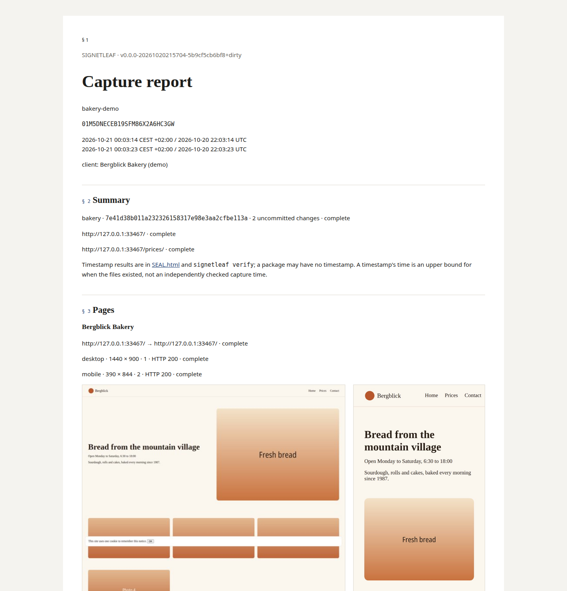
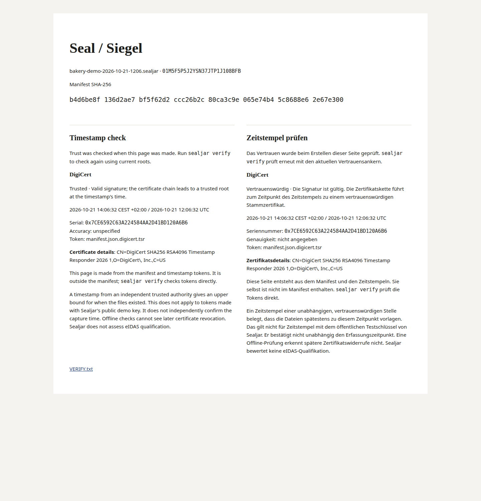

<p align="center">
  <picture>
    <source media="(prefers-color-scheme: dark)" srcset="docs/media/wordmark-dark.svg">
    
  </picture>
</p>
<p align="center"><b>Timestamped captures of your website and code.</b></p>
<p align="center">
  <a href="https://www.sealjar.com">Website</a> ·
  <a href="docs/quickstart.md">Get started</a> ·
  <a href="docs/for-recipients.md">Received a package?</a> ·
  <a href="docs/commands.md">Commands</a> ·
  <a href="AGENTS.md">AGENTS.md</a> ·
  <a href="docs/de/abnahme.md">Deutsch</a>
</p>

Sealjar saves web pages and current code in one ZIP file. You get desktop and mobile
screenshots with a report in English and German. A trusted timestamp shows that the
sealed files existed by the time it records.

## Capture with your coding agent

Copy this prompt and replace the URL with your own. It writes the output to your
repository's parent directory.

```text
Use Sealjar to capture this repository and https://staging.example.com
for handover. Use https://github.com/vincentsch/sealjar: read its AGENTS.md
and follow the steps. Verify the package and show me the report and any
capture problems. Write the output to the parent directory of this repository.
```

For pages behind a login, see [capture](docs/capture.md).

## Install it yourself

One executable runs on Linux, macOS and Windows, on amd64 and arm64. The Bash
installer supports Linux, macOS and Git Bash on Windows. WSL uses Linux assets. The
installer checks SHA-256 checksums before installing.

```sh
curl -fsSL https://raw.githubusercontent.com/vincentsch/sealjar/main/install.sh -o /tmp/sealjar-install.sh
bash /tmp/sealjar-install.sh
rm /tmp/sealjar-install.sh
```

Use the absolute path printed after `Installed:` if it is not on PATH. The examples
below call that executable `sealjar`. [Native Windows downloads and the optional Go
install](docs/quickstart.md#install) are described separately. Native Windows needs
no Go installation.

Chrome or Chromium is needed for web capture and demo. Git is needed for code
capture and demo. You can verify packages without Chrome or Git. You can also
extract stored reports and restore snapshot files without either program. Checking
out a history bundle needs Git. Repository-only capture without Chrome produces
HTML reports without PDFs. `report --pdf` copies stored PDFs; it cannot generate
missing ones.

## Try it

After [installation](#install-it-yourself), run:

```sh
sealjar doctor
sealjar demo --out ../bakery-demo
```

The demo serves a bakery website on your computer and captures an example
repository. The ZIP comes with a folder for reading the reports. A second ZIP has a
changed screenshot, so you can see how verification reports it. If the public
timestamp service is unavailable, it uses a local token labelled “Demo timestamp,
not trusted”. That fallback gives verify exit 11. Its signing key is public, so it
supplies no independent time evidence, even if a supplied root grants it trust.

<p></p>
<p></p>

These images come from a demo run that received a trusted DigiCert timestamp. The
report points to the seal and `sealjar verify` for timestamp results.

## Capture by hand

From your repository root, write outside it. Here `..` is the parent directory;
check it is the destination you want. List each authorised URL explicitly.

```sh
OUT=$(cd .. && pwd -P)
sealjar capture https://staging.example.com . --out "$OUT" --dry-run
```

Check the full plan, including exclusions and the absolute output directory. If it
matches what you want to capture, run:

```sh
sealjar capture https://staging.example.com . --out "$OUT" --confirm --no-prompt
```

Read the complete plan, including exclusions. Add pages or hosts as more URL
arguments; Sealjar does not crawl. The package can combine those pages with one Git
repository. Tracked files include current uncommitted edits. `--include-untracked`
adds files Git does not ignore. `--history` adds a Git bundle, which can contain old
secrets and unrelated work. Submodules are listed without their contents; LFS
pointers remain pointers unless already materialised.

Default exclusions cover `.env` and common key files. The plan lists excluded
candidates and reasons. Add `--exclude 'build/'` or `--exclude '*.key'` as needed. A
trailing slash excludes a folder tree; `**` is unsupported. These rules cannot
remove all private content. Read [capture and privacy](docs/capture.md) before
sharing source or screenshots.

## Check a package

Use the path printed by capture:

```sh
sealjar verify package.sealjar.zip
```

Verification reports capture problems separately from file changes and timestamp
trust. A capture can have problems even when verify exits 0. Exit 10 means changed
or invalid content; exit 11 means no trusted timestamp.
[Verification](docs/verify.md) explains the results.

A recipient can open `report/report.en.html` in the paired reader folder and follow
its relative image links. Keep the folder together. The report PDF is a standalone
reading copy. Neither requires installing Sealjar to read. [Manual
verification](docs/verify.md#without-installing-sealjar) uses Python 3 for
manifest-file hashes and OpenSSL for the timestamp, with independent roots and the
token's time. `VERIFY.txt` inside the ZIP contains the same steps.

Matching hashes establish agreement with the manifest. They cannot authenticate an
untimestamped manifest. The timestamp does not independently check when capture
happened. A package cannot show whether its content is true or complete. It cannot
establish that the operator was honest or that a server sent the saved bytes. It
also cannot establish delivery or acceptance of a project, or link the captured code
to the website. No legal effect or admissibility is promised. For important
disputes, consider a neutral expert or notary during capture.

## Timestamps and network access

DigiCert is the default authority; FreeTSA is the fallback. Repeat `--tsa` to use
custom authorities instead. `stamp` adds tokens later without changing the manifest
or captured files. See [timestamps](docs/timestamps.md).

Trust comes from system root certificates or the embedded FreeTSA root. You can also
supply roots obtained independently. Certificates carried in the package cannot
grant trust. Offline checks cannot see later revocation. Sealjar v0.1 does not
assess eIDAS qualification or label timestamps qualified.

Capture loads the target pages and their resources. It also contacts DNS servers and
timestamp authorities. A timestamp authority receives a hash and normal network
metadata. Timestamp requests use standard proxy settings; doctor's connection probes
do not honour proxies. Metadata masking and exclusions cannot remove all private
content. Screenshots and rendered HTML may show it; source files and Git history may
contain it too. Inspect the package before sharing it. There are no Sealjar accounts
or automatic package uploads.

## Read more

The [quickstart](docs/quickstart.md) covers your first capture. The [recipient
guide](docs/for-recipients.md) explains what to do with a package. For other
questions, see the [FAQ](docs/faq.md) or [command reference](docs/commands.md).
German guides cover [Abnahme](docs/de/abnahme.md) and [empfangene
Pakete](docs/de/fuer-empfaenger.md).

Sealjar is [MIT licensed](LICENSE). For source changes, read
[CONTRIBUTING.md](CONTRIBUTING.md).
